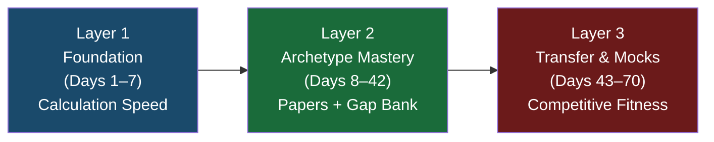
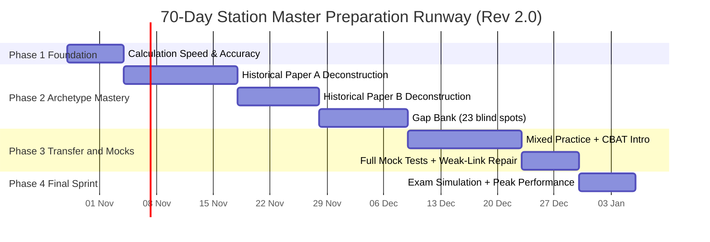
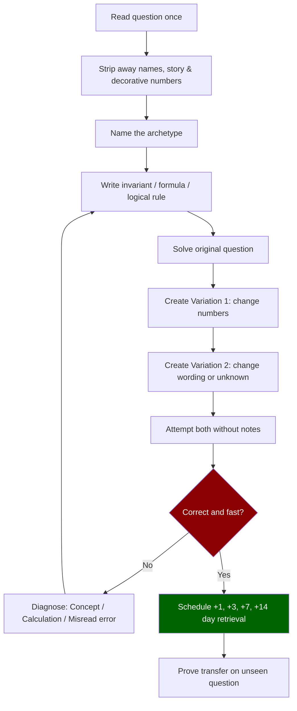

# 🚂 70-Day RRB Station Master Preparation Plan
### CEN 08/2026 | Evidence-Based & Competitive Strategy | Revision 2.0 (Syllabus-Verified)

> [!IMPORTANT]
> **Exam Date**: Not yet announced. Application window: 27 Oct – 25 Nov 2026. This 70-day plan runs from **Day 1 (28 Oct 2026)** through **Day 70 (5 Jan 2027)** as a training milestone, not a confirmed exam date. Monitor [rrbapply.gov.in](https://www.rrbapply.gov.in) and [rrb.indianrailways.gov.in](https://rrb.indianrailways.gov.in) for the official CBT date announcement.

> [!NOTE]
> **Post & Medical Requirements**: Station Master is a Level 6 post requiring a graduate degree (age band 20–33 as of 1 Jan 2027, with standard category relaxations as applicable). Medical Standard: **A-2** — vision 6/9 in both eyes without glasses; **LASIK/eye surgery is a strict disqualifier**.

---

## Exam Blueprint at a Glance

| Parameter | Detail |
|:---|:---|
| **Duration** | 120 minutes |
| **Total Questions** | 100 (1 mark each) |
| **Negative Marking** | −1/3 per wrong answer |
| **Selection Formula** | 70% CBT Score + 30% CBAT Score |
| **Stages** | CBT → Computer-Based Aptitude Test (CBAT) → DV → Medical |
| **CBAT Minimum** | T-score ≥ 42 in **every** battery (no category relaxation) |
| **Net Score Formula** | Net = Correct − (Wrong ÷ 3) |

---

## Official Syllabus (100 Marks — Zero General Knowledge!)

```
┌──────────────────────────────────────────────────────────────┐
│  SECTION 1: Basic Science, Mathematics & Data (60 Marks)     │
│  ├── Basic Science & Mathematics ................. 30 Marks   │
│  │   ├── Mathematics (15 topics)                              │
│  │   │   Number System · LCM & HCF · Ratio & Proportion      │
│  │   │   Averages · Percentages · Profit/Loss & Discounts     │
│  │   │   Time & Work · Speed/Time/Distance · Linear Eq        │
│  │   │   Algebra · AP · Geometry · Trigonometry               │
│  │   │   Area & Volumes (Mensuration) · Probability & Stats   │
│  │   └── Basic Physics (10 topics)                            │
│  │       Units & Measurements · Mass/Weight/Density           │
│  │       Work/Power/Energy · Kinetic Energy · Friction        │
│  │       Speed & Velocity · Relative Velocity                 │
│  │       Heat & Temperature · Basic Electricity               │
│  │       Levers & Simple Machines                             │
│  └── Data Analysis & Interpretation ............. 30 Marks   │
│      Tabular · Charts & Graphs · Scatter Plots               │
│      Pie Charts · Statistical Curve Distributions            │
│      Venn Diagrams · Data Sufficiency · Data Arrangement     │
│      Multi-source Data Analysis                              │
│                                                              │
│  SECTION 2: Logical Capability .................. 20 Marks   │
│  ├── Logical Reasoning (7 types)                             │
│  │   Binary Logic · Syllogisms · Clocks & Calendars          │
│  │   Assumptions · Blood Relations · Family Tree             │
│  │   Logic-based Puzzles                                     │
│  └── English Reading Comprehension (4 skill types)          │
│      Main Idea · Supporting Idea                            │
│      Application/Inference · Logical Structure & Style      │
│                                                              │
│  SECTION 3: Mental Reasoning ................... 20 Marks    │
│  Analogy · Series Completion · Coding-Decoding              │
│  Ranking · Seating Arrangements                             │
└──────────────────────────────────────────────────────────────┘
```

> [!WARNING]
> **Syllabus audit (Rev 2.0)** found 6 missing/partial topics and 4 structural issues in the original plan. All have been corrected below. See the [Syllabus Alignment Audit](file:///C:/Users/VAIBHAV/.gemini/antigravity/brain/0608650f-5665-4dc2-ac68-5b96a462c814/Syllabus_Alignment_Audit.md) for the full audit report.

---

## Strategic Framework: The 3-Layer Approach

Based on the deep research report's empirical audit of 2020 NTPC papers vs CEN 08/2026 syllabus:



### Question Triage Rule (Apply to Every Practice Question)
| Tag | Meaning | Action |
|:---|:---|:---|
| **A — Direct** | Explicit CEN 08/2026 archetype | Deeply deconstruct → formula → variants → 1-3-7-14 retrieval |
| **B — Transferable** | Develops useful calculation/logic skill | Solve once or twice; retain the method |
| **C — Legacy** | Old NTPC GA/GK material | Classify and move on; do NOT waste 20 min on it |

---

## The 52 Operational Archetypes — Complete Mastery Checklist (Rev 2.0)

> [!NOTE]
> After the syllabus audit, the archetype count has been corrected to **52** (previously 48). Four topics were under-represented or missing: **Family Tree** (separate from Blood Relations), **Logic-based Puzzles** (separate from simple assumptions), **Multi-source DI** (combining two chart types), and **Mensuration** (elevated to dedicated focus). All are now explicitly assigned.

### ✅ Covered by Old Papers (29 archetypes)
Number System · Ratio & Proportion · Averages · Percentages · Profit/Loss/Discounts · Time/Speed/Distance · Power & Work · Algebra · Linear Equations · LCM & HCF · Geometry · Trigonometry · Area & Volumes · Statistics · Units & Measurements · Mass/Weight/Density · Tabular DI · Charts & Graphs · Pie Chart · Venn Diagrams · Syllogism · Assumptions · Blood Relations · Logic Puzzles · Analogy · Series Completion · Coding-Decoding · Ranking · Arrangements

### 🔴 Blind Spots to Fill (23 archetypes — Revised Gap Bank)
Arithmetic Progression · Probability · Physics Work/Power/Energy/KE · Friction · Speed & Velocity (physics concept) · Relative Velocity · Heat & Temperature · Basic Electricity · Levers & Simple Machines · Textual/Multi-source DI · **Multi-source DI (two-chart combining)** · Scatter Plot · Statistical Curve Distribution · Data Sufficiency · Data Arrangement · Binary Logic · Clocks & Calendars · **Family Tree** · **Logic-based Puzzles (floor/scheduling/circular)** · **Mensuration (dedicated reinforcement)** · RC: Main Idea · RC: Supporting Idea · RC: Application/Inference · RC: Logical Structure & Style

> [!IMPORTANT]
> Items in **bold** are newly added in Rev 2.0 — they were missing or under-represented in the original plan.

---

## 70-Day Master Schedule (Rev 2.0 — Syllabus-Verified)



| Phase | Days | Focus | Key Output |
|:---|:---:|:---|:---|
| **1 — Foundation** | 1–7 | Arithmetic speed, tables, fractions | Gate: 80% on 40Q arithmetic |
| **2A — Paper A** | 8–21 | Deconstruct 100Q, tag A/B/C, variants | Gate: 80% on 50Q unseen transfer test |
| **2B — Paper B** | 22–31 | Deconstruct Paper B, consolidate maths/DI | Gate: 80% variants |
| **2C — Gap Bank** | 32–42 | All 23 blind spots + Mensuration + Family Tree + Puzzles | Gate: All 52 archetypes touched |
| **3 — Mocks** | 43–56 | Full mocks, CBAT, error repair | Gate: Stable mock score, T-score trend ≥45 |
| **4 — Final Sprint** | 57–70 | 7 full mocks, peak accuracy, zero new content after Day 68 | Gate: ≥85% attempted accuracy |

---

## PHASE 1: Foundation (Days 1–7) — Calculation Speed

> [!TIP]
> **Do NOT race on Day 1.** Your bottleneck is calculation hesitation, not missing knowledge. Fix accuracy first; speed follows automatically.

### Daily Structure (Phase 1)
- **Evening/Night (2 hours)**: Concept drills + calculation sets
- **Commute (1 hour)**: Audio recall loops (prompt → pause → answer)
- **Exercise (45 min)**: Light verbal review only — no visual DI or diagrams

| Day | Evening Focus | Gate to Clear |
|:---:|:---|:---|
| **1** | Tables 12–15; Squares 1–15; Cancellation intro; 20 drills | ≥ 16/20 untimed |
| **2** | Tables 16–20; Squares 16–25; ×5/×25/×50 shortcuts; mixed drill | ≥ 80% on 30 facts |
| **3** | Fraction ↔ Decimal ↔ Percentage anchors; ratio simplification | ≥ 85% on 20 cancellations |
| **4** | Divisibility rules (2/3/4/5/6/8/9/10/11); HCF/LCM; division | ≥ 18/20 decisions |
| **5** | BODMAS; powers; roots; estimation; option elimination | ≥ 85% on 25 |
| **6** | Fast percentages; ratios; averages; 40-question arithmetic set | ≥ 80% + record median time |
| **7** | **Foundation Test**: 40Q/45min; analyse every error; retest misses | ≥ 80%; table recall ≤ 5 sec |

### Fast Recovery Rules for Tables 12–20
| Table | Recovery Rule | Example |
|:---|:---|:---|
| 12 | 10n + 2n | 12×8 = 80+16 = **96** |
| 13 | 10n + 3n | 13×7 = 70+21 = **91** |
| 14 | 10n + 4n (or double 7n) | 14×9 = 140−14 = **126** |
| 15 | 10n + 5n | 15×6 = 60+30 = **90** |
| 16 | Double 8n | 16×7 = 56×2 = **112** |
| 17 | 20n − 3n | 17×6 = 120−18 = **102** |
| 18 | 20n − 2n | 18×8 = 160−16 = **144** |
| 19 | 20n − n | 19×7 = 140−7 = **133** |
| 20 | 2n then append zero | 20×13 = **260** |

---

## PHASE 2: Archetype Mastery (Days 8–42)

### The Reverse-Engineering Protocol (Apply to Every Question)



**Mastery Rule**: An archetype is only mastered when you can solve **at least 2 of 3 unseen variants correctly in two separated sessions**, and explain the method without notes.

### Days 8–21: Paper A Deconstruction

**Daily Structure**: 20 min due retrieval → 70 min deconstruction → 20 min unfamiliar variants → 10 min error log

| Day | Focus | Gate |
|:---:|:---|:---|
| **8** | Paper A Q1–10 | Tag every Q as A/B/C |
| **9** | Paper A Q11–20 | ≥ 80% variants |
| **10** | Paper A Q21–30 | ≥ 80% |
| **11** | Paper A Q31–40 | ≥ 80% |
| **12** | Paper A Q41–50 | ≥ 80% |
| **13** | Paper A Q51–60 | ≥ 80% |
| **14** | Paper A Q61–70 | ≥ 80% |
| **15** | Paper A Q71–80 | ≥ 80% |
| **16** | Paper A Q81–90 | ≥ 80% |
| **17** | Paper A Q91–100 | ≥ 80% |
| **18** | Consolidate all Paper-A **maths** archetypes + 15 unseen variants | ≥ 12/15 |
| **19** | Consolidate Paper-A **reasoning** archetypes + 15 unseen | ≥ 12/15 |
| **20** | Salvage relevant science; discard legacy-GA burden | Explain A/B/C triage |
| **21** | 🧪 **50Q Unseen Transfer Test / 60 min + 60 min review** | ≥ 80% attempted accuracy |

> [!CAUTION]
> Day 21 test: **A repeated Paper-A answer does NOT count as a success.** Only unfamiliar questions count.

### Days 22–42: Paper B + Complete Gap Bank (Rev 2.0)

> [!IMPORTANT]
> **Rev 2.0 fix**: Gap Bank is now **23 blind spots** (was 19). Added: Family Tree, Logic-based Puzzles, Multi-source DI (two-chart combining), and Mensuration reinforcement. Days 36–42 are now restructured — Day 42 was previously overloaded with Clocks + all 4 RC types. That has been split across Days 41–42.

| Day | Focus | Gate |
|:---:|:---|:---|
| **22** | Paper B Q1–10 | ≥ 80% variants |
| **23** | Paper B Q11–20 | ≥ 80% |
| **24** | Paper B Q21–30 | ≥ 80% |
| **25** | Paper B Q31–40 | ≥ 80% |
| **26** | Paper B Q41–50 | ≥ 80% |
| **27** | Paper B Q51–60 | ≥ 80% |
| **28** | Paper B Q61–70 | ≥ 80% variants |
| **29** | Paper B Q71–80 | ≥ 80% |
| **30** | Paper B Q81–90 | ≥ 80% |
| **31** | Paper B Q91–100 | ≥ 80% |
| **32** | Paper-B **maths** consolidation + 20 unseen maths variants | ≥ 16/20 |
| **33** | Paper-B **reasoning/DI** consolidation + 15 unseen | ≥ 12/15 |
| **34** | Build A+B matrix; **24Q gap pre-test BEFORE studying gaps** | Record baseline score |
| **35** | Paper-A 14-day retest + Paper-B due queue + 30 mixed Q | Repeated Qs excluded from mastery count |
| **36** | 🔴 **Gap**: Arithmetic Progression (G1–G2) + Probability (G3–G4) | ≥ 80% + 2 unseen variants each |
| **37** | 🔴 **Gap**: Work/Power/Energy/KE (G5–G6) + Friction (G7–G8) | ≥ 80% |
| **38** | 🔴 **Gap**: Speed & Velocity physics concept + Relative Velocity (G9–G11) + Heat (G12–G13) | ≥ 80%; explain scalar vs vector |
| **39** | 🔴 **Gap**: Electricity (G14–G16) + Levers & Simple Machines (G17–G18) | ≥ 80% |
| **40** | 🔴 **Gap**: **Mensuration reinforcement** (cuboid, cylinder, cone, sphere — 8Q) + scatter plots (G23–G24) | ≥ 80% on all; know all volume/area formulas |
| **41** | 🔴 **Gap**: Tabular DI (G19–G22) + **Charts & Graphs** (3 bar/line DI sets) + **Multi-source DI** (2 combined-chart sets) | ≥ 80%; read chart type before numbers |
| **42** | 🔴 **Gap**: Statistical distributions (G25–G26) + Data Sufficiency (G27–G29) + Data Arrangement (G30–G32) | ≥ 80% |
| **43** (was Day 41 content) | 🔴 **Gap**: Binary Logic (G33–G35) + Clocks & Calendars (G36–G37) + **Family Tree** (5 multi-gen tree Q) | ≥ 80%; draw tree for every Family Tree Q |
| **44** (was Day 42 content) | 🔴 **Gap**: **Logic-based Puzzles** (5Q: floor puzzle, scheduling, circular) + RC: Main Idea (G38–G40) + RC: Supporting Idea (G41–G43) | **All 52 archetypes touched ✅**; ≥ 80% |
| **45** | 🔴 **Gap consolidation**: RC Application (G44–G46) + RC Logical Structure (G47–G48) + full gap-bank re-test (24Q unseen) | ≥ 80% on unseen gap Q |

---

## PHASE 3: Transfer & Mocks (Days 46–59)

> [!IMPORTANT]
> **CBAT Reminder**: T-score ≥ 42 in **every** battery is mandatory. One strong battery cannot compensate for a failed one. Do NOT ignore CBAT practice.

**Error Log — Use Only These 5 Labels:**
`Concept Gap` · `Calculation Error` · `Misread` · `Time-Management Failure` · `Bad Guess`

| Day | Evening Focus | Measurement |
|:---:|:---|:---|
| **46** | 30Q mixed/45 min; review; first CBAT sample familiarisation | Establish CBT + CBAT baseline |
| **47** | 30Q DI/RC/45 min; review arithmetic | ≥ 80% attempted accuracy |
| **48** | 40Q/50 min; review; 30 min CBAT sample | Record raw/time/T-score |
| **49** | 40Q maths/science/50 min + speed drill | ≥ 82% attempted |
| **🧪 50** | **Full CBT Mock 1: 100Q / 120 min** | Net = C − W/3 |
| **51** | Mock-1 autopsy; redo errors; CBAT practice | Label every error type |
| **52** | 50Q/60 min mixed | ≥ 83% attempted |
| **53** | 30Q DI/RC speed + CBAT | Aim for T-score buffer ≥ 45 |
| **54** | 50Q/60 min + maths repair | ≤ 2 careless arithmetic errors |
| **🧪 55** | **Full CBT Mock 2** | Improve score vs Mock 1 |
| **56** | Mock-2 autopsy + weakest-3 list | Identify 3 recurring error causes |
| **57** | 60Q/72 min + CBAT | ≥ 84% attempted |
| **58** | Repair weakest 3 + 10 unseen transfer Q | ≥ 8/10 fresh questions |
| **59** | 60Q/72 min | No late-exam collapse pattern |

---

## PHASE 4: Final Sprint (Days 60–70)

| Day | Focus | Checkpoint |
|:---:|:---|:---|
| **🧪 60** | **Full CBT Mock 3** | Compute rolling 3-mock median |
| **61** | Mock-3 autopsy + CBAT weak batteries | No CBAT battery neglected |
| **62** | 80Q/96 min | ≥ 84% attempted accuracy |
| **🧪 63** | **Full CBT Mock 4** | Stable/rising 3-mock median |
| **64** | Mock-4 autopsy + redo | ≤ 5 weak archetypes remain |
| **65** | Weak-link set + CBAT + speed | Personal CBAT buffer ≥ 47 |
| **🧪 66** | **Full Mock 5** | ≤ 3 careless errors |
| **67** | 4×10Q speed blocks: Maths/DI/Reasoning/Science+RC | Accuracy must survive speed |
| **🧪 68** | **Full Mock 6** | Rolling accuracy ≥ 85% |
| **69** | Review + CBAT + gap-bank retest (sampled); **No new content after today** | ≥ 90% on sampled gap questions |
| **🧪 70** | **Full Mock 7 — Final Benchmark** | Record negative-mark loss; confirm readiness |

> [!TIP]
> **What "ready" looks like**: Three simultaneous signals — (1) stable unseen-mock performance, (2) attempted-question accuracy ≥ 85%, (3) no large archetype-specific hole. These are training criteria, not RRB cutoffs.

---

## Time Strategy During the Exam (72 seconds average per question)

> [!NOTE]
> 120 minutes ÷ 100 questions = 72 seconds average. But this should be **uneven**. Simple arithmetic: 30–45 sec. DI passages: 90–120 sec. RC: 90–120 sec. Puzzles/arrangements: 90–120 sec.

### Suggested Exam Sequence
1. **Round 1 (0–50 min)**: All Mental Reasoning questions (high speed, low time) + simple Maths
2. **Round 2 (50–90 min)**: Physics/Science + Logical Reasoning + RC passages
3. **Round 3 (90–120 min)**: All DI sets (read set once, answer all sub-questions together)

### Negative Marking Strategy
- **Attempt confidently** when you can eliminate ≥ 2 options (Expected value is positive)
- **Skip** when all 4 options seem equally possible (expected loss = −1/3 per attempt)
- **Never guess randomly** — the penalty is real

---

## Key Formulas Quick-Reference

### Speed Conversion (The 18 & 5 Rule)
$$18 \text{ km/h} = 5 \text{ m/s} \quad\rightarrow\quad \times\frac{5}{18} \text{ to convert km/h → m/s}$$

### Time & Work (LCM Method)
$$\text{Total Work} = \text{LCM(days)}; \quad \text{Efficiency} = \frac{\text{Total Work}}{\text{Individual Days}}$$

### Physics Essentials
| Formula | Meaning |
|:---|:---|
| $W = F \times d$ | Work done |
| $P = W/t$ | Power |
| $KE = \frac{1}{2}mv^2$ | Kinetic Energy |
| $F_{friction} = \mu N$ | Limiting Friction |
| $V = IR,\ P = VI$ | Ohm's Law, Electrical Power |
| $Q = mc\Delta T$ | Heat absorbed |
| $K = °C + 273$ | Celsius to Kelvin |
| $MA = \text{Load}/\text{Effort}$ | Mechanical Advantage |

### AP Formulas
$$T_n = a + (n-1)d \qquad S_n = \frac{n}{2}[2a + (n-1)d]$$

### Equal-Distance Average Speed (TRAP!)
$$\text{Average Speed} = \frac{2uv}{u+v} \quad \text{(NOT (u+v)/2)}$$

### Compound Interest Rate Shortcut
$$r = \frac{\text{Amount}_{n+1} - \text{Amount}_n}{\text{Amount}_n} \times 100$$

### ⭐ Mensuration — All Key Formulas (Day 40 Focus)

| Shape | Area | Volume / Perimeter |
|:---|:---|:---|
| Rectangle | $l \times b$ | Perimeter = $2(l+b)$ |
| Triangle | $\frac{1}{2} \times b \times h$ | $\sqrt{s(s-a)(s-b)(s-c)}$ (Heron's) |
| Circle | $\pi r^2$ | Circumference = $2\pi r$ |
| Cuboid | Surface Area = $2(lb+bh+lh)$ | Volume = $l \times b \times h$ |
| Cube | $6a^2$ | $a^3$ |
| Cylinder | $2\pi r(r+h)$ | $\pi r^2 h$ |
| Cone | $\pi r(r+l)$ where $l=\sqrt{r^2+h^2}$ | $\frac{1}{3}\pi r^2 h$ |
| Sphere | $4\pi r^2$ | $\frac{4}{3}\pi r^3$ |
| Cuboid diagonal | — | $\sqrt{l^2+b^2+h^2}$ |

### ⭐ Speed & Velocity — Physics Concept
| Term | Definition |
|:---|:---|
| **Speed** | Scalar; magnitude of rate of change of distance |
| **Velocity** | Vector; speed + direction |
| **Instantaneous velocity** | Velocity at a specific instant |
| **Average velocity** | Total displacement ÷ total time |
| **Uniform velocity** | Constant speed in a straight line |

### ⭐ Statistics — Math Computation Formulas
$$\text{Mean} = \frac{\sum x}{n} \qquad \text{Median} = \text{middle value when sorted}$$
$$\text{Mode} = \text{most frequent value}$$
$$\text{Range} = \text{Max} - \text{Min}$$

> **Symmetric distribution**: Mean = Median = Mode  
> **Positively skewed**: Mean > Median > Mode  
> **Negatively skewed**: Mean < Median < Mode

### ⭐ Probability — Key Rules
$$P(\text{Event}) = \frac{\text{Favourable outcomes}}{\text{Total outcomes}}$$
$$P(A \cup B) = P(A) + P(B) - P(A \cap B)$$
$$P(A \cap B) = P(A) \times P(B) \quad \text{(if A and B are independent)}$$
$$P(\bar{A}) = 1 - P(A) \quad \text{(complement rule)}$$

---

## Progress Tracking System

### Weekly Check-in Template
Every Sunday, answer these 5 questions:
1. **Mock score this week?** (Net = C − W/3)
2. **Top 3 error types from the error log?**
3. **Which archetypes are still below 80% variant accuracy?**
4. **CBAT practice done? Estimated T-score trend?**
5. **Any missed days? How to compensate?**

### Score Progression Targets
| Week | Target Attempted Accuracy | Mock Performance |
|:---:|:---|:---|
| Week 1–2 | Foundation only | N/A |
| Week 3–4 | 80% on variants | — |
| Week 5–6 | 80% on unseen | — |
| Week 7 | 82% | Mock 1 |
| Week 8 | 83–84% | Mock 2 |
| Week 9 | 84–85% | Mocks 3–4 |
| Week 10 | ≥ 85% | Mocks 5–6 |
| Final days | ≥ 85–87% | Mock 7 benchmark |

---

## The Complete 23-Topic Gap Bank (Rev 2.0)

> [!NOTE]
> **Expanded from 19 to 23 blind spots** after syllabus audit. New additions are marked ⭐.

| Gap Area | Key Practice | Target Day |
|:---|:---|:---|
| Arithmetic Progression (G1–G2) | AP nth term, AP sum | Day 36 |
| Probability (G3–G4) + **extra** | Coin+die, colored balls, **P(A∪B), complement rule** | Day 36 |
| Physics Work/Power/Energy/KE (G5–G6) | KE formula, Power from work | Day 37 |
| Friction (G7–G8) | Limiting friction, why friction matters | Day 37 |
| ⭐ Speed & Velocity physics concept | Scalar vs vector; instantaneous vs average; units | Day 38 |
| Relative Velocity (G9–G11) | Same/opposite direction, equal-distance avg | Day 38 |
| Heat & Temperature (G12–G13) | Kelvin conversion, mixing temperatures | Day 38 |
| Basic Electricity (G14–G16) | Ohm's law, series/parallel circuit, power | Day 39 |
| Levers & Simple Machines (G17–G18) | Moments, mechanical advantage | Day 39 |
| ⭐ Mensuration reinforcement | Cuboid, cylinder, cone, sphere — area + volume formulas | Day 40 |
| Scatter Plot (G23–G24) | Positive/zero/negative association | Day 40 |
| Tabular DI (G19–G22) | % change, combined totals from tables | Day 41 |
| ⭐ Charts & Graphs (dedicated) | 3 bar-chart + 3 line-graph DI sets | Day 41 |
| ⭐ Multi-source DI (two-chart combining) | Table + Pie / Table + Line chart combining sets | Day 41 |
| Statistical Curve Distribution (G25–G26) + **Stats math** | Normal distribution, skewness + **mean/median/mode computation from data** | Day 42 |
| Data Sufficiency (G27–G29) | 1-statement, 2-statement, ratio alone | Day 42 |
| Data Arrangement (G30–G32) | Linear order, day sequence | Day 42 |
| Binary Logic (G33–G35) | XOR, AND, Implication (P→Q) | Day 43 |
| Clocks & Calendars (G36–G37) | Angle at 3:30, day after N days | Day 43 |
| ⭐ Family Tree (5 practice Q) | Multi-generation trees with gender + relations | Day 43 |
| ⭐ Logic-based Puzzles (5 practice Q) | Floor puzzle, day-scheduling, circular seating | Day 44 |
| RC: Main Idea (G38–G40) | 3 different passage types | Day 44 |
| RC: Supporting Idea (G41–G43) | Evidence identification | Day 44 |
| RC: Application/Inference (G44–G46) | What-follows questions | Day 45 |
| RC: Logical Structure & Style (G47–G48) | Passage organisation | Day 45 |

---

## CBAT Preparation Notes

> [!IMPORTANT]
> CBAT uses **T-score ≥ 42** as the mandatory pass in every battery. Final merit = **70% CBT + 30% CBAT**. Check the official RDSO Traffic & Psychology Candidate's Corner at: `https://rdso.indianrailways.gov.in/view_section.jsp?lang=0&id=0,2,456,5821,611`

- CBAT has **no negative marking**
- No category relaxation on the T-score 42 floor
- One weak battery cannot be compensated by a strong one
- Practice CBAT from Day 43 onward alongside CBT mocks

---

## Resource Map

| File | Purpose |
|:---|:---|
| [`01_Official_Syllabus_and_Exam_Pattern.md`](file:///c:/Users/VAIBHAV/Desktop/RRB_StationMaster_Prep/01_Official_Syllabus_and_Exam_Pattern.md) | Exam rules, syllabus, key parameters |
| [`02_Master_Shortcuts_and_Formulas.md`](file:///c:/Users/VAIBHAV/Desktop/RRB_StationMaster_Prep/02_Master_Shortcuts_and_Formulas.md) | Formulas, speed tricks, squares table |
| [`03_The_45_Gap_Filler_Questions_and_Answers.md`](file:///c:/Users/VAIBHAV/Desktop/RRB_StationMaster_Prep/03_The_45_Gap_Filler_Questions_and_Answers.md) | 45 gap-filler Q&A for blind spots |
| [`deep-research-report (1).md`](file:///c:/Users/VAIBHAV/Desktop/RRB_StationMaster_Prep/deep-research-report%20(1).md) | Empirical audit, 48 archetypes, 75-day workbook |
| [`CEN_08_2026_StationMaster.pdf`](file:///c:/Users/VAIBHAV/Desktop/RRB_StationMaster_Prep/CEN_08_2026_StationMaster.pdf) | Official recruitment notification |

---

## Day 1 Action Checklist (Start Tonight)

- [ ] Print or save the **Tables 12–20 reference table** from the research report
- [ ] Complete the **20 calculation drills** in the research report (attempt without looking at answers first)
- [ ] Set up a **physical error log** (notebook or spreadsheet) with the 5 error labels
- [ ] Download **RRB NTPC 28 Dec 2020 Shift 1** paper for deconstruction starting Day 8
- [ ] Bookmark `rrbapply.gov.in` and `rrb.indianrailways.gov.in` for exam date alerts
- [ ] Check the RDSO Candidate's Corner and download any available CBAT sample materials
- [ ] Apply for the exam (Application window: 27 Oct – 25 Nov 2026) on `rrbapply.gov.in`

---

## Final Notes

> [!WARNING]
> **Do NOT treat repetition as mastery.** Scoring 90% on a paper you've already seen means nothing. Only unfamiliar question variants count toward mastery.

> [!CAUTION]
> **Vacancy discrepancy in the official CEN**: "vacancies at a glance" page shows **1,215** while Annexure-B row totals add to **1,265**. Both are listed in the same document. Wait for an RRB corrigendum before using either number in calculations. The competition level is high regardless.

> [!TIP]
> **The optimal final-week mindset**: No new content after Day 68. Trust your preparation. Focus on stamina, accuracy, and negative-marking discipline. Know your "skip" threshold.

---

*Plan generated: 27 October 2026 | **Revision 2.0** (Syllabus-verified 27 Oct 2026)*
*Based on CEN 08/2026 official notification and empirical 48→52 archetype audit*
*See [Syllabus Alignment Audit](file:///C:/Users/VAIBHAV/.gemini/antigravity/brain/0608650f-5665-4dc2-ac68-5b96a462c814/Syllabus_Alignment_Audit.md) for gap analysis details*
