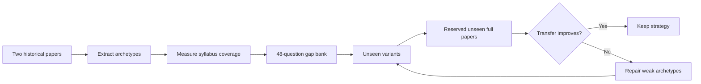
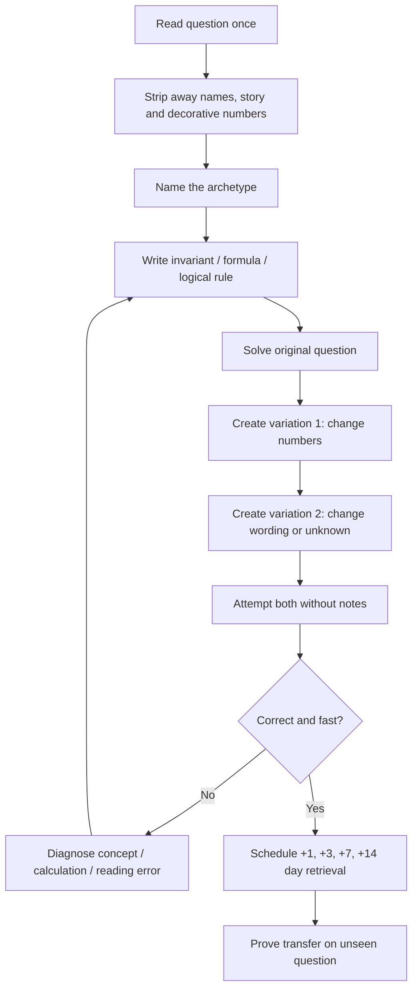
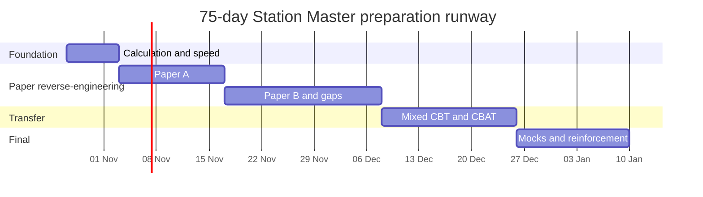

# RRB Station Master CEN 08/2026: Empirical Test of the Two-Paper Reverse-Engineering Strategy

## Executive summary

Your idea is **good, but the empirical audit changes one crucial part of it**.

The right strategy is **not**:

> “Master every concept behind all 200 questions from two old NTPC papers.”

The better strategy is:

> **“Use two genuine historical papers as a concept-discovery engine; deeply master only questions that transfer to CEN 08/2026, then deliberately fill the archetypes the old papers cannot cover, and prove transfer on completely unseen papers.”**

That distinction matters because the **new Station Master CBT is structurally different from the old NTPC CBT-I**. Your uploaded CEN 08/2026 specifies a single 100-question, 120-minute CBT divided indicatively into 60 marks for Basic Science/Mathematics/Analytical Capability, 20 for Logical Capability and 20 for Mental Reasoning. It explicitly adds substantial **Data Interpretation, English Reading Comprehension, basic physics, binary logic and other topics** that were not central to the 2020 NTPC CBT-I. The old 2020 paper format, by contrast, used 30 Mathematics, 30 General Intelligence/Reasoning and 40 General Awareness questions. fileciteturn0file0 citeturn32search3turn32search6

I selected the **28 December 2020 Shift 1 and Shift 2 RRB NTPC CBT-I papers**. The Shift-1 archive preserves response-sheet metadata such as the test date, 10:30–12:00 timing and official-style question/option IDs, while multiple independent archives index both shifts as historical RRB NTPC papers. The original candidate response sheets are no longer available as a stable live RRB archive, so I describe these as **archived historical response-sheet reproductions**, not as files currently hosted by RRB. citeturn32search0turn32search4turn32search6

The official CEN does **not** state that there are “48 archetypes”; in fact, it warns that its topic list is illustrative rather than exhaustive. For a reproducible audit, I decomposed its wording into **48 operational archetypes**. Under that fixed taxonomy, the two-paper evidence I could securely recover touches **at least 29 of 48 archetypes = 60.4%**. The most serious blind spots are exactly the subjects that distinguish the new examination: Arithmetic Progression, Probability, energy/kinetic energy, friction, relative velocity, heat, electricity, simple machines, textual/multi-source DI, scatter plots, distribution curves, data sufficiency, data arrangement, binary logic, clocks/calendars and all four English RC skills. fileciteturn0file0

There is an important evidence limitation. I could stably reconstruct **all 100 questions of Shift 1 and the first 58 numbered questions plus several identifiable tail items of Shift 2** from the public archives. I will **not fabricate question numbers for the unrecoverable Shift-2 tail**. Therefore 60.4% is a **verified lower bound**, rather than pretending to possess an exact 200-question percentage that the source record does not support.

The proposed **48-question gap bank** below explicitly covers all 19 observed blind spots. On the operational taxonomy, that takes nominal *exposure coverage* from 29/48 to 48/48. It does **not** mean you have mastered 100% of the exam: an archetype only becomes “mastered” when you can solve unfamiliar variants under time pressure.

Your 75-day runway from **27 October 2026 through 9 January 2027** gives you 150 hours of high-cognition desk study, up to 75 hours of commute audio and 56.25 hours of exercise audio. The notice itself does **not announce a CBT date**, so January/February must not be treated as an official examination date merely because the modification window closes on 7 December 2026. fileciteturn0file0

Station Master is Level 6 with a graduate-degree requirement, normal age 20–33 as at 1 January 2027 (with standard reserved category relaxations as applicable per the official notification). The post carries strict A-2 medical requirements, which should be reviewed carefully. fileciteturn0file0

There is **no conventional interview stage** in this CEN. The process is CBT → CBAT → document verification → medical examination. CBT has one-third negative marking. CBAT requires **T-score 42 in every test battery with no category relaxation**, has no negative marking, and final merit uses 70% CBT plus 30% CBAT. fileciteturn0file0

**My empirical verdict:** your strategy is highly usable **after modification**. Two papers should supply the seed archetypes, not define the syllabus. The winning structure is:

**2 historical papers → 48-question gap bank → unfamiliar variants → unseen full papers → CBAT.**

[Download the complete 75-day Excel workbook](sandbox:/mnt/data/RRB_Station_Master_75_Day_Reverse_Engineering_Workbook.xlsx)

## Evidence base and empirical verdict

The uploaded CEN changes the optimisation problem. Its CBT is 100 questions in 120 minutes with one-third negative marking. The official syllabus includes 30 marks of Basic Science and Mathematics and another 30 marks of Data Analysis and Interpretation, followed by 20 marks each of Logical Capability and Mental Reasoning. English reading comprehension is explicitly part of Logical Capability. fileciteturn0file0

The two historical papers selected are:

| Audit paper | Historical examination | Why selected | Evidence quality |
|---|---|---|---|
| Paper A | RRB NTPC CBT-I, 28 Dec 2020, Shift 1 | Complete 100-question reconstruction available; archive preserves response-sheet metadata and question IDs | Strong archival reproduction, but not currently RRB-hosted |
| Paper B | RRB NTPC CBT-I, 28 Dec 2020, Shift 2 | Same examination day/cycle; allows independent transfer comparison | Historical paper indexed by multiple archives; stable question numbering only partly recoverable in this research pass |

The Shift-1 response-sheet reproduction displays the date, time, NTPC subject, question IDs and the original marking rule, while independent historical-paper indexes list both 28 December shifts. citeturn32search0turn32search4turn32search6

This matters because an old paper is **not a random sample from the new 2026 syllabus**. The 2020 paper blueprint itself contained 40 General Awareness questions, whereas the new CEN's named syllabus is oriented towards science, maths, DI, logical capability, RC and mental reasoning. citeturn32search3 fileciteturn0file0

In Paper A, my classification places **49/100 questions directly into one of the new CEN operational archetypes**. The remaining 51 are predominantly old-style current affairs/static GA or reasoning/maths forms not explicitly named in the new notice. That does *not* imply that such questions can never appear—the notice says its list is illustrative—but it means you should not devote equal study time to every old question. citeturn32search0turn32search2 fileciteturn0file0

That produces a simple three-tag rule for your reverse engineering:

| Tag | Meaning | What you do |
|---|---|---|
| **A — direct** | Explicit CEN 08/2026 archetype | Deeply deconstruct; derive formula/rule; solve variants; schedule 1-3-7-14 retrieval |
| **B — transferable** | Not explicitly listed but develops useful calculation/logical skill | Solve once or twice; retain only useful method |
| **C — legacy** | Old current-affairs/static-GA material with weak connection to new syllabus | Classify and move on; do **not** spend 20 minutes “mastering” it |

This is the biggest improvement to your original idea. Without triage, the “master every concept in 200 questions” rule can waste a large fraction of your limited 150 desk hours on the obsolete structure of the older examination.

The testable version of your strategy therefore becomes:

\[
\text{Coverage}=\frac{\text{official archetypes encountered}}{\text{operational official archetypes}}
\]

but **mastery** is stricter. I recommend recording an archetype as mastered only after you can solve unfamiliar variants rather than the memorised historical item. A useful personal criterion is **at least 2 of 3 unseen variants correct in two separated sessions**, with the method explainable without looking at notes. That threshold is a training rule, not an RRB rule.

The experimental design is straightforward:

Crucially, do **not** use every historical shift as learning material. The archive contains many other 2020/2021 shifts that can be preserved as holdout tests. citeturn32search4turn32search6 If you repeatedly solve the same two papers, you will eventually score almost perfectly even if your general ability has barely improved. Your unseen papers are the empirical check against that illusion.

For CBT scoring, track:

\[
\text{Net score} = C-\frac{W}{3}
\]

where \(C\) is correct answers and \(W\) wrong answers, because the CEN deducts one-third mark per incorrect CBT response. fileciteturn0file0

The CEN's *minimum qualifying* CBT floor is category-dependent (e.g. 40% UR/EWS, 30% OBC/SC, 25% ST). These are only qualification minima, **not selection targets**; shortlisting for CBAT is merit-based and limited to roughly eight times RRB-wise vacancies. fileciteturn0file0

## Archetype mapping and coverage audit

The official CEN does not publish an “archetype count”. I created the following **48-unit operational taxonomy** by splitting its syllabus phrases into question-generating families. This is preferable to claiming an artificial “official total”. The CEN also explicitly leaves open topics beyond the listed examples, so any percentage must be interpreted relative to a stated taxonomy. fileciteturn0file0

In the table, Paper A IDs are complete. Paper B IDs are those I could verify with stable numbering; `tail*` means the item was visible in the archived tail but its exact numbered position was not stable enough to report honestly. Frequencies are therefore **verified minima** rather than inflated estimates. The historical-paper identification is supported by the archived response sheet and independent paper indexes. citeturn32search0turn32search4turn32search6

| CEN operational archetype | Paper A IDs | Paper B verified IDs | Verified minimum frequency |
|---|---:|---:|---:|
| Number System | 12, 25, 28, 56, 59, 68, 75, 76 | 18, 27, 47 | **11** |
| Ratio & Proportion | 17, 26 | 32 | **3** |
| Averages | — | 10 | **1** |
| Percentages | 41, 71, 82 | 30 | **4** |
| Profit, Loss & Discounts | 32 | 24 | **2** |
| Time, Speed & Distance | 77 | — | **1** |
| Power & Work | 63 | 19, 46, 53 | **4** |
| Algebra | 52, 79 | 9 | **3** |
| Linear Equations | 57 | — | **1** |
| **Arithmetic Progression** | — | — | **0** |
| LCM & HCF | 29, 54, 55 | 22, 40 | **5** |
| Geometry | 40, 83 | 14, 28, 36 | **5** |
| Trigonometry | 18, 69, 85 | 21 | **4** |
| Area & Volumes | 74 | 31 | **2** |
| **Probability** | — | — | **0** |
| Statistics | 65 | 17 | **2** |
| Units & Measurements | 24 | — | **1** |
| Mass, Weight & Density | 78 | 35 | **2** |
| **Work/Power/Energy/Kinetic Energy — physics** | — | — | **0** |
| **Friction** | — | — | **0** |
| **Speed/Velocity/Relative Velocity — physics** | — | — | **0** |
| **Heat & Temperature** | — | — | **0** |
| **Basic Electricity** | — | — | **0** |
| **Levers & Simple Machines** | — | — | **0** |
| **Textual/Multi-source DI** | — | — | **0** |
| Tabular DI | — | 33, 57 | **2** |
| Charts & Graphs | — | 49 | **1** |
| **Scatter Plot** | — | — | **0** |
| Pie Chart | — | 54 | **1** |
| **Statistical Curve Distribution** | — | — | **0** |
| Venn Diagrams | — | tail* | **1** |
| **Data Sufficiency** | — | — | **0** |
| **Data Arrangement** | — | — | **0** |
| **Binary Logic** | — | — | **0** |
| Syllogism | 95 | 13 | **2** |
| **Clocks & Calendars** | — | — | **0** |
| Assumptions | — | 56, 58 | **2** |
| Blood Relations & Family Tree | 88 | tail evidence also present | **≥1** |
| Logic Puzzles | — | 55 | **1** |
| **RC: Main Idea** | — | — | **0** |
| **RC: Supporting Idea** | — | — | **0** |
| **RC: Application/Inference** | — | — | **0** |
| **RC: Logical Structure & Style** | — | — | **0** |
| Analogy | 35, 42, 64, 86, 97 | 7 + tail evidence | **≥6** |
| Series Completion | 10, 84, 92, 94, 99 | tail evidence | **≥5** |
| Coding-Decoding | 51 | 20, 26, 44 | **4** |
| Ranking | 72, 100 | — | **2** |
| Arrangements | 22, 91, 93 | 4 | **4** |

The old papers therefore strongly expose you to **number system, LCM/HCF, geometry, trigonometry, percentages, work/time, analogy, series, coding and arrangements**. That is useful.

But the problem is the zeros.

There are **19 observed blind spots**:

**Arithmetic Progression; Probability; physics Work/Power/Energy/Kinetic Energy; Friction; Speed/Velocity/Relative Velocity; Heat/Temperature; Basic Electricity; Levers/Simple Machines; Textual/Multi-source DI; Scatter Plot; Statistical Curve Distribution; Data Sufficiency; Data Arrangement; Binary Logic; Clocks/Calendars; and the four RC skills.** All of these are explicitly represented in the new syllabus wording. fileciteturn0file0

Thus:

\[
\frac{29}{48}\times100 = \mathbf{60.4\%}
\]

is the verified operational coverage.

That is nowhere near enough to justify a pure “two papers and nothing else” strategy.

It is especially significant that much of the missing material sits in **Data Analysis & Interpretation, which belongs to the 60-mark Basic Science/Mathematical/Analytical block**, and in Reading Comprehension under the 20-mark Logical Capability block. fileciteturn0file0

There is another important conclusion from the audit: **frequency in a 2020 paper is not an estimate of probability in the 2026 Station Master CBT**. For example, five old series questions do not prove that series will be five times as important as electricity. The examination blueprint has changed. The correct use of frequency is to see what your two seed papers naturally teach you—not to forecast exact 2026 question counts.

The archived Shift-1 paper contains recognisable examples such as rhombus-angle percentages, analogy, blood relations, numerical series and seating arrangements, illustrating how much old-paper material still transfers at the *question-form* level. citeturn32search2

## Gap-filler prescription and deconstruction framework

To reach **90% operational archetype coverage**, you need at least:

\[
0.90\times48=43.2\Rightarrow44
\]

archetypes.

You already have evidence for 29, so the mathematical minimum is **15 additional archetypes**. One question from each would technically take you to 44/48 = 91.7% *exposure coverage*, but that would be a poor mastery test.

A much more defensible minimum is the **48-question bank** below: roughly two to four questions for each of the 19 blind spots. It can give you nominal exposure to **48/48 of the operational taxonomy**, while still fitting into roughly 10–11 focused hours.

| Missing archetype | Gap questions | Suggested module time |
|---|---:|---:|
| Arithmetic Progression | G1–G2 | 25 min |
| Probability | G3–G4 | 30 min |
| Energy / Kinetic Energy / Power | G5–G6 | 25 min |
| Friction | G7–G8 | 20 min |
| Relative velocity | G9–G11 | 35 min |
| Heat & Temperature | G12–G13 | 25 min |
| Basic Electricity | G14–G16 | 40 min |
| Levers & Simple Machines | G17–G18 | 25 min |
| Textual/Multi-source DI | G19–G22 | 45 min |
| Scatter Plot | G23–G24 | 25 min |
| Statistical Curve Distribution | G25–G26 | 25 min |
| Data Sufficiency | G27–G29 | 35 min |
| Data Arrangement | G30–G32 | 45 min |
| Binary Logic | G33–G35 | 35 min |
| Clocks & Calendars | G36–G37 | 30 min |
| RC Main Idea | G38–G40 | 40 min |
| RC Supporting Idea | G41–G43 | 40 min |
| RC Application/Inference | G44–G46 | 45 min |
| RC Logical Structure/Style | G47–G48 | 30 min |

These topics come directly from the CEN syllabus; the question bank itself is newly written for this workbook rather than copied from copyrighted coaching material. fileciteturn0file0

**The complete 48-question gap bank**

| ID | Question | Answer |
|---|---|---|
| G1 | AP: 7, 11, 15, … Find the 25th term. | **103** |
| G2 | AP with \(a=5,d=3\). Find sum of first 20 terms. | **670** |
| G3 | Fair coin + fair die. Probability of Head and an even die result? | **1/4** |
| G4 | Bag: 5 red, 3 blue, 2 green. Probability of not drawing blue? | **7/10** |
| G5 | KE of 4 kg body travelling at 6 m/s? | **72 J** |
| G6 | A 200 N load is lifted 5 m in 10 s. Power? | **100 W** |
| G7 | \(\mu=0.2\), normal force = 50 N. Limiting friction? | **10 N** |
| G8 | Why can a vehicle not accelerate on a perfectly frictionless road? | **No tyre-road static friction** |
| G9 | Vehicles at 72 and 54 km/h, same direction. Relative speed? | **5 m/s** |
| G10 | Trains at 45 and 63 km/h, opposite directions. Relative speed? | **30 m/s** |
| G11 | Equal distances at 60 and 40 km/h. Average speed? | **48 km/h** |
| G12 | 27°C in kelvin, using 273 offset? | **300 K** |
| G13 | Equal masses of the same liquid at 20°C and 60°C mixed without loss. Final temperature? | **40°C** |
| G14 | 12 V across 4 Ω. Current? | **3 A** |
| G15 | 2 Ω and 3 Ω in series across 10 V. Current? | **2 A** |
| G16 | Appliance draws 2 A at 220 V. Power? | **440 W** |
| G17 | Load 120 N at 0.5 m; effort arm 1.5 m. Required effort? | **40 N** |
| G18 | Machine lifts 200 N with 50 N effort. Mechanical advantage? | **4** |
| G19 | Train A: 800→920 passengers; B: 700→840. Percentage increase in combined total? | **17.33%** |
| G20 | 240 workers; 60% technical; 25% of technical staff women. Number? | **36** |
| G21 | Store A sells 120,150,180; B sells 100,140,210. Larger total and difference? | **Equal: 450 each** |
| G22 | Output 400→460; defects 20→15. Percentage changes? | **+15%, −25%** |
| G23 | Scatter points generally rise from lower-left to upper-right. Interpretation? | **Positive association** |
| G24 | Scatter points show no directional pattern. Interpretation? | **Little/no linear association** |
| G25 | Perfect symmetric normal distribution: relationship among mean, median, mode? | **Equal** |
| G26 | Positively skewed distribution: mean or median usually larger? | **Mean** |
| G27 | Find \(x\): I \(x+y=10\); II \(y=4\). Sufficiency? | **Together; \(x=6\)** |
| G28 | Triangle area: I base=10; II height=6. Sufficiency? | **Together; 30 cm²** |
| G29 | Find \(x:y\): I \(x=2y\); II \(x+y=18\). Which alone gives ratio? | **I alone** |
| G30 | A left of B; C right of B; D left end; E between B and C. Valid order? | **D-A-B-E-C** |
| G31 | P before Q; R Wednesday; S immediately after Q; T Monday. If Q Thursday, S? | **Friday** |
| G32 | X ahead of Y; W behind Y; Z ahead of X. Order? | **Z-X-Y-W** |
| G33 | \(1\ XOR\ 1\) | **0** |
| G34 | P=true, Q=false. \(P\ AND\ Q\)? | **False** |
| G35 | In classical logic, if P=false, truth value of \(P\Rightarrow Q\)? | **True** |
| G36 | Smaller clock-hand angle at 3:30? | **75°** |
| G37 | Monday today; day 100 days later? | **Wednesday** |
| G38 | Short urban-tree passage: identify central message. | **Trees reduce heat/environmental stress** |
| G39 | Digital-education passage: identify central message. | **Access expands, inequality remains** |
| G40 | Scientific-model passage: central message. | **Useful models simplify while predicting** |
| G41 | Urban-tree passage: choose supporting evidence. | **Shade/lower temperature** |
| G42 | Digital education: which detail qualifies the benefit? | **Device/connectivity inequality** |
| G43 | Model passage: supporting claim? | **Models simplify reality** |
| G44 | Trees removed while heatwaves intensify: inference? | **Heat stress may worsen** |
| G45 | Devices supplied but connectivity poor: inference? | **Access problem remains** |
| G46 | Model omits minor detail but predicts well: necessarily bad? | **No** |
| G47 | “Benefit, but limitation” passage structure? | **Claim followed by qualification** |
| G48 | Scientific-model passage contrasts imitation with what? | **Predictive usefulness** |

**How to reverse-engineer an individual question**

**Historical deconstruction — Mathematics: cuboid diagonal**

A Shift-2 archived question asks for the longest straight object that can fit inside a rectangular room/cuboid; the relevant dimensions in the reconstructed item are 10 m, 8 m and 6 m. The historical 28 December Shift-2 paper is indexed alongside Shift 1 in the archival paper collections. citeturn32search4turn32search6

**Surface:** room dimensions are 10 × 8 × 6.

**Underlying principle:** the longest line inside a cuboid is the space diagonal:

\[
d=\sqrt{l^2+b^2+h^2}
\]

Therefore:

\[
d=\sqrt{10^2+8^2+6^2}
=\sqrt{100+64+36}
=\sqrt{200}
=10\sqrt2
\]

Approximately 14.14 m.

**Variation one:** give the diagonal, length and width and ask for height.

\[
h=\sqrt{d^2-l^2-b^2}
\]

**Variation two:** ask for the longest rod that can fit in a cube of side \(a\):

\[
d=a\sqrt3
\]

**30-second method:** do not find a face diagonal first. Immediately write **square + square + square → square root**.

This is exactly the sort of reverse engineering worth doing: the historical numbers are irrelevant; the 3D Pythagorean structure is reusable.

**Historical deconstruction — Reasoning: numerical series**

The Shift-1 archive contains the series:

69, 55, 26, 13, ?

The archived solution identifies the transformation as the product of the digits plus one. citeturn32search2

Check:

\[
6\times9+1=55
\]

\[
5\times5+1=26
\]

\[
2\times6+1=13
\]

\[
1\times3+1=\boxed4
\]

**Underlying principle:** when ordinary differences fail, test digit operations—sum, product, square, reversal—before searching for exotic patterns.

**Variation one:** remove the “+1”: 72 → 14 → 4 → ?.

**Variation two:** use product +2 or product −1 while preserving the same recognition task.

**30-second method:** with a strange nonlinear sequence of two-digit numbers, test the digits of the previous term before spending time calculating second or third differences.

**Historical deconstruction — Science: mass versus weight**

Paper A contains a Moon/mass question that maps directly onto the new CEN's explicit Mass, Weight and Density topic. fileciteturn0file0 citeturn32search0

**Surface:** a person's location changes from Earth to Moon; what happens to mass?

**Underlying principle:**

\[
\text{mass} = \text{amount of matter}
\]

It does not depend on local gravitational acceleration, whereas

\[
W=mg
\]

does.

So a 60 kg person's **mass remains 60 kg**; their weight changes because \(g\) changes.

**Variation one:** give Earth weight and Moon gravity and ask Moon weight.

**Variation two:** give mass and gravitational acceleration and ask weight.

**30-second elimination:** answers expressed in **kg** should make you think mass; answers in **newtons** should make you think force/weight.

That is the exact depth you should reach on every **A-tag** question.

## Seventy-five-day execution workbook

The CEN gives 120 minutes for 100 CBT questions: an average budget of 72 seconds per question, although actual time should be uneven because DI passages and puzzles take longer than table facts or simple arithmetic. The CBT has one-third negative marking, so this is not a “attempt all at any cost” examination. fileciteturn0file0

Your 75-day structure is:

The CBT date is not announced in the uploaded notice, so **9 January 2027 is a training milestone, not a claimed examination date**. fileciteturn0file0

**Days 1–7 — calculation and speed foundation**

| Day | Night: 2 hours | Commute: 1 hour audio | Exercise: 45 min audio | Gate |
|---|---|---|---|---|
| **1** | Tables 12–15; squares 1–15; cancellation introduction; 20 drills below; correct every miss | 12–15 table prompt→pause→answer loops | Easy 12–15 recall + squares | ≥16/20 untimed |
| **2** | Due recall; tables 16–20; squares 16–25; ×5/25/50 shortcuts; mixed drill | Tables 16–20 and square recall | Tables 12–20 | ≥80% on 30 facts |
| **3** | Fraction↔decimal↔percentage anchors; cancellation; ratio simplification | Fraction/percentage audio anchors | “Fraction of a number” prompts | ≥85% on 20 cancellations |
| **4** | Divisibility 2/3/4/5/6/8/9/10/11; HCF/LCM; division | Divisibility prompts | HCF/LCM examples | ≥18/20 decisions |
| **5** | BODMAS; powers; roots; estimation; option elimination | BODMAS examples | Squares/roots | ≥85% on 25 |
| **6** | Fast percentages; ratios; averages; 40-question arithmetic set | Percent/ratio recall | Mental percentage prompts | ≥80%, record median time |
| **7** | 40-question/45-min foundation test; analyse every error; retest misses | Errors only | Light table/square review | ≥80%; table facts ≤5 sec |

Do **not** try to make Day 1 fast. Your diagnostic showed calculation hesitation is currently the bottleneck. Accuracy is the first gate.

**Days 8–21 — Paper A reverse engineering**

Every Paper-A day follows the same structure: **20 min due retrieval + 70 min deconstruction + 20 min unfamiliar variants + 10 min error log**.

| Day | Night focus | Commute | Exercise | Checkpoint |
|---|---|---|---|---|
| 8 | Paper A Q1–10 | Archetype/rule audio | Today's verbal rules | Tag every Q A/B/C |
| 9 | Q11–20 | Q11–20 rule cues + due cards | Maths/science recall | ≥80% variants |
| 10 | Q21–30 | Q21–30 | Verbal reasoning | ≥80% |
| 11 | Q31–40 | Q31–40 | Formula recall | ≥80% |
| 12 | Q41–50 | Q41–50 | Percent/analogy | ≥80% |
| 13 | Q51–60 | Q51–60 | Coding/algebra | ≥80% |
| 14 | Q61–70 | Q61–70 | Work/statistics/trig | ≥80% |
| 15 | Q71–80 | Q71–80 | Percent/TSD/mass | ≥80% |
| 16 | Q81–90 | Q81–90 | Series/blood relation | ≥80% |
| 17 | Q91–100 | Q91–100 | Arrangement/ranking | ≥80% |
| 18 | Consolidate all Paper-A maths archetypes + 15 unseen variants | Maths formula deck | Formula→example recall | ≥12/15 |
| 19 | Consolidate Paper-A reasoning + 15 unseen | Reasoning audio deck | Series/analogy/ranking | ≥12/15 |
| 20 | Salvage relevant science; discard legacy-GA burden | Units/mass/statistics | Science definitions | Can explain A/B/C triage |
| 21 | **50-question unseen transfer test, 60 min; 60-min review** | Missed concepts only | Light recovery | ≥80% attempted accuracy |

A repeated Paper-A answer does **not count** as a success on Day 21. Only unfamiliar questions count.

**Days 22–42 — Paper B and gap filling**

| Day | Night focus | Commute | Exercise | Gate |
|---|---|---|---|---|
| 22 | Paper B Q1–10 | Rules before answers | Today's concepts | ≥80% variants |
| 23 | Q11–20 | Due queue + rules | Verbal recall | ≥80% |
| 24 | Q21–30 | Same | Maths | ≥80% |
| 25 | Q31–40 | Same | DI/geometry | ≥80% |
| 26 | Q41–50 | Same | Coding/work | ≥80% |
| 27 | Q51–60 | Same | Logic/DI | ≥80% |
| 28 | Q61–70 from your saved paper; verify IDs before logging | Due cards | Non-visual rules | Never invent uncertain archive ID |
| 29 | Q71–80 | Same | Same | ≥80% variants |
| 30 | Q81–90 | Same | Same | ≥80% variants |
| 31 | Q91–100 | Same | Same | ≥80% variants |
| 32 | Paper-B maths consolidation + 20 unseen maths | Both-paper formula deck | Mental arithmetic | ≥16/20 |
| 33 | Paper-B reasoning/DI consolidation + 15 unseen | DI + reasoning audio | Verbal reasoning | ≥12/15 |
| 34 | Build Paper-A/Paper-B matrix; take 24-question gap pre-test **before studying gaps** | Name all 48 archetypes | Recall 19 gaps | Record baseline |
| 35 | 14-day Paper-A retest + Paper-B due queue + 30 mixed Q | Due cards | Error recall | Repeated questions excluded from mastery |
| 36 | G1–G4: AP + Probability | AP/probability rules | Simple examples | ≥80% + unseen variants |
| 37 | G5–G8: Energy + Friction | Physics definitions | Physics recall | ≥80% |
| 38 | G9–G13: Relative velocity + Heat | Velocity/temperature | Verbal conversion | ≥80% |
| 39 | G14–G18: Electricity + Levers | \(V=IR,P=VI\), moments | Formula recall | ≥80% |
| 40 | G19–G26: Text DI + Scatter + Distributions | DI narration | Data interpretations | ≥80% |
| 41 | G27–G35: Sufficiency + Arrangement + Binary Logic | Sufficiency/binary rules | Verbal logic | ≥80% |
| 42 | G36–G48: Clock + all RC families | Audio RC passages | Main idea/inference | **All 48 operational archetypes touched** |

This phase deliberately ends on **7 December 2026**, the end of the modification window in the uploaded CEN. That date is administratively significant but does not itself predict the CBT date. fileciteturn0file0

**Days 43–60 — mixed transfer and CBAT**

The CEN says approximately eight times the RRB-wise vacancies are shortlisted for CBAT, every CBAT battery requires T-score 42, there is no category relaxation and no CBAT negative marking. Final merit gives 70% weight to CBT and 30% to CBAT. fileciteturn0file0

Do **not** convert a random third-party raw percentage into a supposed RDSO T-score. A T-score depends on a scoring norm. When a genuinely calibrated practice system reports a comparable T-score, 42 is the official qualifying threshold; my suggested 45–47 training targets below are only personal safety buffers, not RRB rules.

| Day | Night | Commute/exercise | Measurement |
|---|---|---|---|
| 43 | 30Q mixed/45m; review; first official-RDSO-sample familiarisation | Mixed formula cues | Establish CBT + CBAT baseline |
| 44 | 30Q DI/RC/45m; review arithmetic | RC audio | ≥80% attempted accuracy |
| 45 | 40Q/50m; review; 30m CBAT sample | Errors + CBAT instructions | Record raw/time/T-score if genuinely calibrated |
| 46 | 40Q maths/science/50m + speed drill | Physics/math audio | ≥82% attempted |
| **47** | **Full CBT Mock 1: 100Q/120m** | Recovery only | Net = C − W/3 |
| 48 | Mock-1 autopsy; redo; CBAT | Error audio | Label every error type |
| 49 | 50Q/60m mixed | Due cards | ≥83% attempted |
| 50 | 30Q DI/RC speed; CBAT | RC/DI | Heuristic calibrated target ≥45 |
| 51 | 50Q/60m + maths repair | Calculation audio | ≤2 careless arithmetic errors |
| **52** | **Full CBT Mock 2** | Recovery | Improve score or reduce errors |
| 53 | Mock-2 autopsy + weakest-three list | Error deck | Identify 3 recurring causes |
| 54 | 60Q/72m + CBAT | Due queue | ≥84% attempted |
| 55 | Repair weakest 3 + 10 unseen transfer Q | Weak-three lessons | ≥8/10 fresh |
| 56 | 60Q/72m | Science/RC | No late-exam collapse |
| **57** | **Full CBT Mock 3** | Recovery | Compute rolling 3-mock median |
| 58 | Mock-3 autopsy + CBAT | Weak-battery audio | No CBAT battery neglected |
| 59 | 80Q/96m | Question-selection rules | ≥84% attempted accuracy |
| **60** | **Full CBT Mock 4** | Recovery | Stable/rising 3-mock median |

Your error log should use only five labels:

**Concept gap · Calculation error · Misread · Time-management failure · Bad guess**

That makes the intervention obvious. Reading another chapter will not fix a misread problem; another formula sheet will not fix uncontrolled guessing.

**Days 61–75 — examination simulation and weak-link removal**

| Day | Night | Commute/exercise | Checkpoint |
|---|---|---|---|
| 61 | Mock-4 autopsy + redo | Error deck | ≤5 weak archetypes remain |
| 62 | Weak-link set + CBAT + speed | Weak-link audio | Personal CBAT buffer target ≥47 if properly calibrated |
| 63 | 60Q/72m + CBAT | Mixed cards | ≥85% attempted |
| **64** | **Full Mock 5** | Recovery | ≤3 careless errors |
| 65 | Mock-5 autopsy + repairs | Errors | Every miss gets written rule |
| 66 | Four 10Q speed blocks: maths/DI/reasoning/science-RC | Speed cues | Accuracy must survive speed |
| **67** | **Full Mock 6** | Recovery | Rolling accuracy target ≥85% |
| 68 | Review + CBAT + sampled gap-bank retest | Gap-bank audio | ≥90% on sampled gap questions |
| 69 | Hardest three archetypes + DI/RC | Hard-three audio | ≥2/3 unseen each |
| **70** | **Full Mock 7** | Recovery | Record negative-mark loss |
| 71 | Review + one-page formula sheet + CBAT | Formula-sheet narration | Personal calibrated CBAT target ≥47 |
| **72** | **Full Mock 8** | Recovery | No significant regression |
| 73 | Mock review + complete 1/3/7/14 due queue + CBAT | High-yield errors only | Due queue = zero |
| **74** | **Final full Mock 9** | No cramming | Final benchmark |
| 75 | 30m errors + 30m formulas/tables + 30m gap recall + 20m light CBAT + 10m “do not change” list | Calm summary only | No new content |

A sensible CBT readiness signal is not a magical raw score because the eventual competitive cutoff is not yet known. Instead, by the final week you want three things simultaneously: **stable unseen-mock performance, attempted-question accuracy around or above 85%, and no large archetype-specific hole**. These are training criteria, not official cutoffs.

For CBAT, the non-negotiable official criterion remains **T-score ≥42 in every test battery**. One exceptionally strong battery cannot compensate for a failed one. fileciteturn0file0

The CEN directs candidates to the RDSO Traffic & Psychology Candidate's Corner for CBAT information. I could not independently retrieve the current RDSO candidate materials in this research session, so I have deliberately **not invented battery names or raw-score conversion tables**. fileciteturn0file0

## Day-one workbook module and first worked gap solutions

Tonight's job is intentionally basic. Your earlier diagnostic showed that **12×8 was secure but tables 13–15, squares and cancellation were not yet reliable**. So there is no benefit in racing into trigonometry tonight.

**Tables 12–20: recovery rules**

| Table | Fast recovery rule | Example |
|---|---|---|
| **12** | \(10n+2n\) | \(12×8=80+16=96\) |
| **13** | \(10n+3n\) | \(13×7=70+21=91\) |
| **14** | \(10n+4n\), or double \(7n\) | \(14×9=140-14=126\) |
| **15** | \(10n+5n\) | \(15×6=60+30=90\) |
| **16** | double \(8n\) | \(16×7=56×2=112\) |
| **17** | \(20n-3n\) | \(17×6=120-18=102\) |
| **18** | \(20n-2n\) | \(18×8=160-16=144\) |
| **19** | \(20n-n\) | \(19×7=140-7=133\) |
| **20** | \(2n\), then append zero | \(20×13=260\) |

Your goal is eventually direct retrieval, but these rules give you a reliable escape route whenever memory stalls.

**Reference table**

| × | 12 | 13 | 14 | 15 | 16 | 17 | 18 | 19 | 20 |
|---:|---:|---:|---:|---:|---:|---:|---:|---:|---:|
| 1 | 12 | 13 | 14 | 15 | 16 | 17 | 18 | 19 | 20 |
| 2 | 24 | 26 | 28 | 30 | 32 | 34 | 36 | 38 | 40 |
| 3 | 36 | 39 | 42 | 45 | 48 | 51 | 54 | 57 | 60 |
| 4 | 48 | 52 | 56 | 60 | 64 | 68 | 72 | 76 | 80 |
| 5 | 60 | 65 | 70 | 75 | 80 | 85 | 90 | 95 | 100 |
| 6 | 72 | 78 | 84 | 90 | 96 | 102 | 108 | 114 | 120 |
| 7 | 84 | 91 | 98 | 105 | 112 | 119 | 126 | 133 | 140 |
| 8 | 96 | 104 | 112 | 120 | 128 | 136 | 144 | 152 | 160 |
| 9 | 108 | 117 | 126 | 135 | 144 | 153 | 162 | 171 | 180 |
| 10 | 120 | 130 | 140 | 150 | 160 | 170 | 180 | 190 | 200 |

**Tonight's 20 calculation drills**

Do them first **without looking at the answer column**.

| # | Question | Answer | Fastest reliable method |
|---|---|---:|---|
| 1 | \(12×7\) | **84** | \(70+14\) |
| 2 | \(13×8\) | **104** | \(80+24\) |
| 3 | \(14×9\) | **126** | \(140-14\) |
| 4 | \(15×6\) | **90** | \(60+30\) |
| 5 | \(16×7\) | **112** | \(8×7=56\), double |
| 6 | \(17×6\) | **102** | \(120-18\) |
| 7 | \(18×8\) | **144** | \(160-16\) |
| 8 | \(19×7\) | **133** | \(140-7\) |
| 9 | \(20×13\) | **260** | \(2×13×10\) |
| 10 | \(13×12\) | **156** | \(130+26\) |
| 11 | \(17^2\) | **289** | \((20-3)^2=400-120+9\) |
| 12 | \(23^2\) | **529** | \((20+3)^2=400+120+9\) |
| 13 | \(25^2\) | **625** | Anchor square: memorise |
| 14 | \((18×25)/9\) | **50** | \(18/9=2\), then \(2×25\) |
| 15 | \((14×15)/7\) | **30** | \(14/7=2\), then \(2×15\) |
| 16 | \((24×35)/(6×7)\) | **20** | \(24/6=4;\ 35/7=5;\ 4×5\) |
| 17 | \(48÷6×15\) | **120** | \(8×15\) |
| 18 | \(3/4\) of 240 | **180** | \(240÷4×3\) |
| 19 | 12.5% of 160 | **20** | \(12.5\%=1/8\) |
| 20 | 75% of 84 | **63** | \(75\%=3/4;\ 84÷4×3\) |

On your first attempt, aim for **16/20 correct without a timer**. Once that happens, repeat a reordered version and target 18/20. Only then start pushing time.

**Day-one commute audio script**

You can put the following text into any text-to-speech reader.

**Minutes 0–5:**  
“Accuracy before speed. Twelve times seven… pause… eighty-four. Twelve times eight… ninety-six. Twelve times nine… one hundred eight. Recovery rule: multiply by ten and add twice the number.”

**Minutes 5–15:**  
“Thirteen times seven… pause… ninety-one. Thirteen times eight… one hundred four. Thirteen times nine… one hundred seventeen. Recovery rule: ten groups plus three groups.”

Then:

“Fourteen times seven… ninety-eight. Fourteen times eight… one hundred twelve. Fourteen times nine… one hundred twenty-six. For times nine, multiply by ten and subtract one group.”

Then:

“Fifteen times six… ninety. Fifteen times seven… one hundred five. Fifteen times eight… one hundred twenty. Fifteen times nine… one hundred thirty-five.”

**Minutes 15–25 — reverse recall:**  
“Eighty-four divided by twelve? … seven. Ninety-one divided by thirteen? … seven. One hundred four divided by thirteen? … eight. One hundred twenty-six divided by fourteen? … nine. One hundred twenty divided by fifteen? … eight.”

This forces you to learn the multiplication relationship in both directions.

**Minutes 25–35 — squares:**  
“Ten squared 100. Eleven squared 121. Twelve squared 144. Thirteen squared 169. Fourteen squared 196. Fifteen squared 225.”

Then pause before each answer and recall it yourself.

**Minutes 35–45 — cancellation:**  
“Eighteen times twenty-five divided by nine. Do not multiply first. Cancel eighteen divided by nine to two. Two times twenty-five equals fifty.”

“Fourteen times fifteen divided by seven. Cancel fourteen by seven to two. Two times fifteen equals thirty.”

“Twenty-four times thirty-five divided by six times seven. Cancel twenty-four by six to four. Cancel thirty-five by seven to five. Four times five equals twenty.”

**Minutes 45–60:** repeat only the items you could not answer within roughly three seconds.

During exercise, make it lighter: first 15 minutes tables 12–15; next 15 minutes squares; final 15 minutes verbally explain cancellation and the ×9/×19 shortcuts. Do not attempt visual DI, seating diagrams or difficult algebra while exercising.

**First twenty gap-filler worked solutions**

These are the first real “new syllabus blind-spot” lessons after you reach the appropriate phase.

| ID | Fast worked solution |
|---|---|
| **G1** | \(a_n=a+(n-1)d=7+24(4)=7+96=\boxed{103}\). |
| **G2** | \(S_n=\frac n2[2a+(n-1)d]\). So \(S_{20}=10[10+57]=\boxed{670}\). |
| **G3** | \(P(H)=1/2\); \(P(\text{even})=3/6=1/2\). Independent events: \(1/2×1/2=\boxed{1/4}\). |
| **G4** | Total 10. Non-blue = 5+2=7. \(P=\boxed{7/10}\). Faster than calculating \(1-3/10\), though both work. |
| **G5** | \(KE=\frac12mv^2=\frac12×4×36=\boxed{72\text{ J}}\). |
| **G6** | Work \(=Fs=200×5=1000\) J. Power \(=W/t=1000/10=\boxed{100\text{ W}}\). |
| **G7** | Limiting friction \(F=\mu N=0.2×50=\boxed{10\text{ N}}\). |
| **G8** | Horizontal acceleration requires tangential tyre-road force. With zero friction, the tyre cannot push backwards on the road, so the road cannot provide the forward static-friction force. |
| **G9** | Same direction → subtract speeds: \(72-54=18\) km/h. Divide by 3.6: \(18/3.6=\boxed5\) m/s. |
| **G10** | Opposite directions → add: \(45+63=108\) km/h. \(108÷3.6=\boxed{30}\) m/s. |
| **G11** | Equal-distance average: \(\frac{2uv}{u+v}=\frac{2×60×40}{100}=\boxed{48}\) km/h. Do not use simple average 50. |
| **G12** | \(K\approx{}^\circ C+273\). \(27+273=\boxed{300\text{ K}}\). |
| **G13** | Equal mass + same material + no loss means the midpoint temperature: \((20+60)/2=\boxed{40^\circ C}\). |
| **G14** | Ohm's law \(I=V/R=12/4=\boxed{3\text{ A}}\). |
| **G15** | Series resistance \(R=2+3=5Ω\). \(I=10/5=\boxed{2\text{ A}}\). |
| **G16** | \(P=VI=220×2=\boxed{440\text{ W}}\). |
| **G17** | Balance moments: \(120×0.5=E×1.5\). So \(E=60/1.5=\boxed{40\text{ N}}\). |
| **G18** | \(MA=\frac{\text{load}}{\text{effort}}=200/50=\boxed4\). |
| **G19** | Monday total \(=800+700=1500\). Tuesday \(=920+840=1760\). Increase 260. \(260/1500×100=\boxed{17.33\%}\). |
| **G20** | Technical \(=240×0.60=144\). Women \(=144×0.25=36\). Shortcut: \(60\%×25\%=15\%\); \(15\%\) of 240 = \(\boxed{36}\). |

The key pattern is that every solution should eventually become:

**recognise archetype → retrieve one rule → perform minimal arithmetic → sanity-check units/options.**

That is considerably more transferable than memorising an answer.

## Source integrity, official constraints and links

The **controlling syllabus used in this report is the CEN 08/2026 PDF you uploaded**. It states the single-stage CBT/CBAT structure, 100 questions/120 minutes, one-third CBT negative marking, syllabus topics, CBAT T-score requirement, age rules and graduate qualification. fileciteturn0file0

One document-quality issue should be noted. The early “vacancies at a glance” page in the uploaded notice shows **1,215**, while Annexure-B's printed row totals add to **1,265**. Because those two figures conflict inside the same document, I would not use either number for strategic calculations until an RRB corrigendum or official webpage resolves it. The discrepancy does not change this preparation syllabus. fileciteturn0file0

I also did not independently retrieve an identical CEN 08/2026 PDF from the unified RRB domain through the indexed web search available in this research session. For application, amendments and exam-date notices, the notice itself instructs candidates to rely on the unified RRB site rather than social-media or coaching material. fileciteturn0file0

Official RRB portal requested in the CEN:

`https://rrb.indianrailways.gov.in`

Official application portal:

`https://www.rrbapply.gov.in`

RDSO Traffic & Psychology / Candidate's Corner route cited by the CEN:

`https://rdso.indianrailways.gov.in/view_section.jsp?lang=0&id=0,2,456,5821,611`

The two historical 28 December 2020 shifts are independently indexed by past-paper archives; EduRev's Shift-1 copy visibly preserves candidate-response-sheet metadata and official-style question IDs, and Prepp's archive indexes answer-key papers for both shifts. citeturn32search0turn32search6

Archived Shift-1 response-sheet reproduction:

`https://edurev.in/p/375736/rrb-ntpc-cbt-1-previous-year-questions-28-dec-2020-shift-1`

Historical paper index containing both 28 December shifts:

`https://prepp.in/rrb-ntpc-exam/practice-papers/`

The strongest conclusion from the empirical audit is therefore not that **two papers are enough**. They are not: under the explicit 48-archetype taxonomy they expose only **at least 60.4%** of the new syllabus families, and the missing 39.6% contains several major new-CEN areas. fileciteturn0file0 citeturn32search0turn32search6

The conclusion is more useful:

> **Two carefully reverse-engineered papers are enough to become the backbone of your preparation, provided you refuse to confuse repetition with mastery and add a deliberately designed 48-question gap bank plus unseen transfer tests.**

That gives you a much more economical programme than reading textbooks cover-to-cover, without accepting the dangerous blind spots of a pure two-paper strategy.